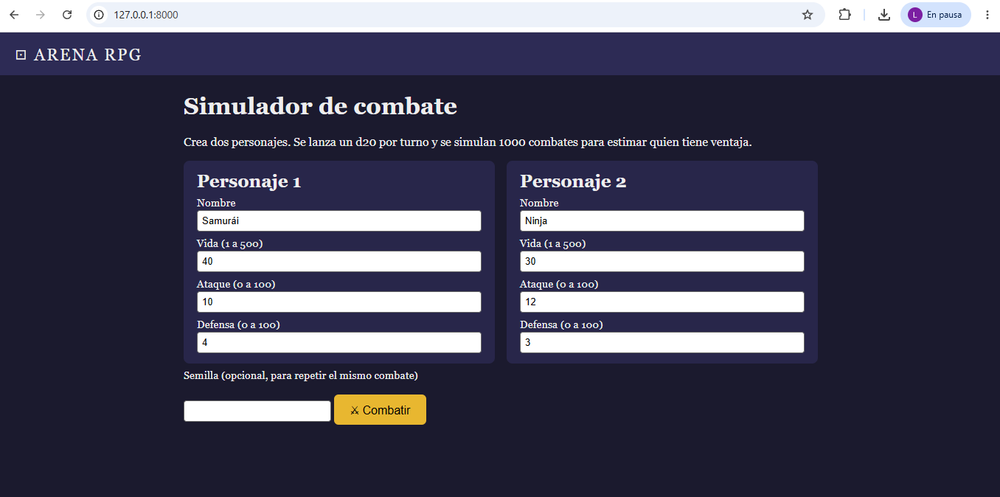
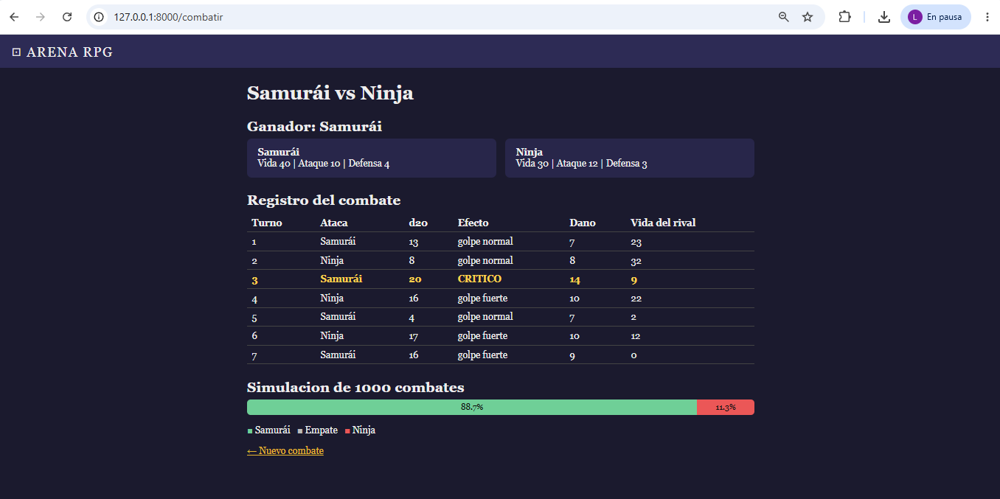
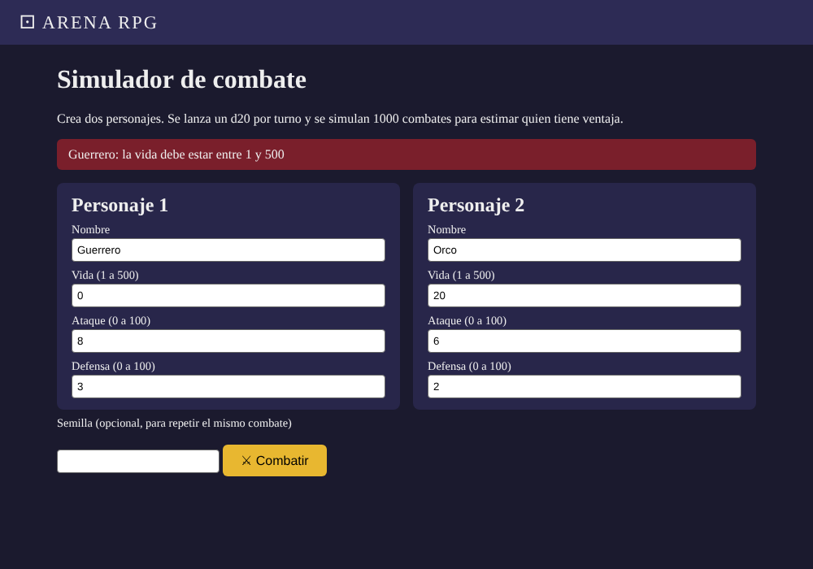
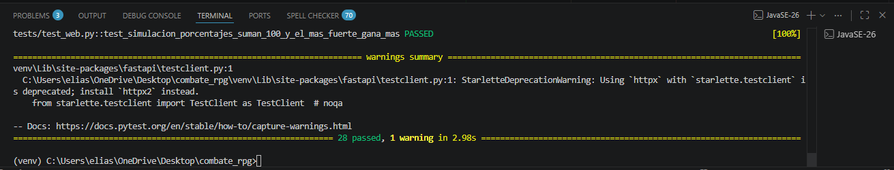
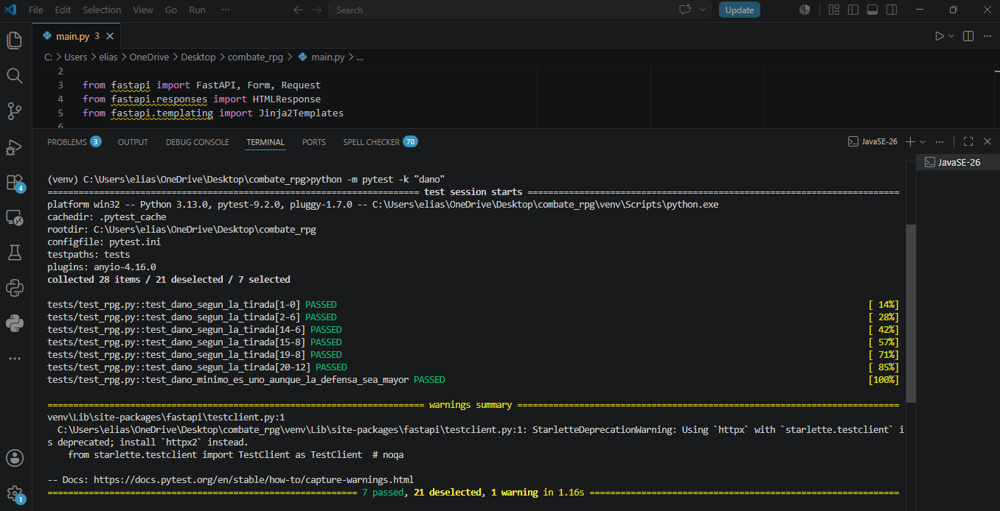
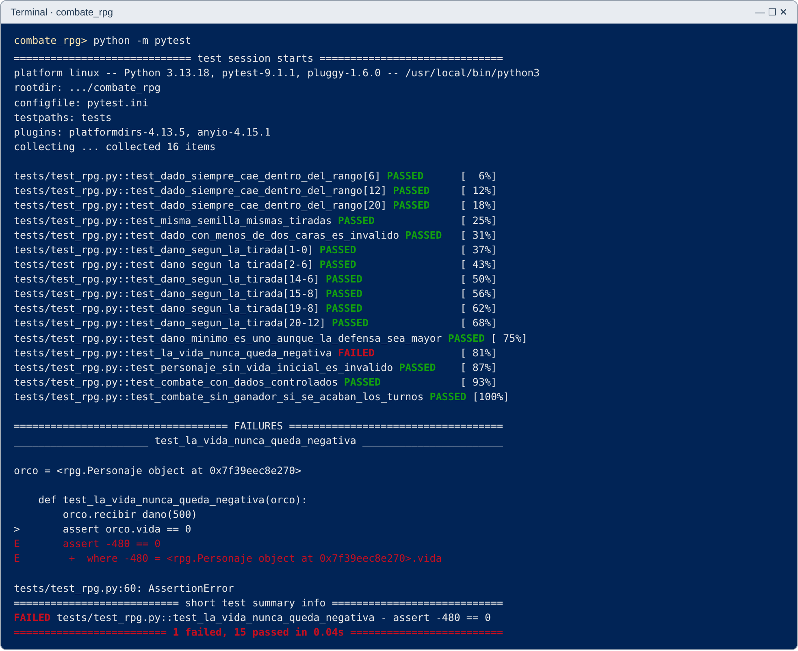

# Arena RPG: simulador de combate con dados

- **Autor:** Libardo Morales Gutierrez
- **Programa:** Ingeniería de Sistemas, Corporación Universitaria Americana
- **Asignatura:** Desarrollo de Aplicaciones Web II

## 1. Presentación del proyecto

**Nombre:** Arena RPG.

**Propósito:** aplicación web que enfrenta a dos personajes de rol en un combate por turnos con un dado de 20 caras (d20) y estima cuál tiene ventaja.

**Problema que resuelve:** en los juegos de rol de mesa es difícil saber si un personaje está bien equilibrado frente a otro, porque cada combate depende del azar. La aplicación permite ver un combate completo turno a turno y, además, repite el enfrentamiento 1000 veces para dar un porcentaje de victoria.

**Funcionalidad principal:** el usuario ingresa nombre, vida, ataque y defensa de dos personajes (y una semilla opcional). La aplicación valida los datos, simula un combate, simula 1000 combates y muestra el ganador, el registro de turnos y la barra de porcentajes.

Reglas del combate:

| Tirada d20 | Efecto | Daño |
|---|---|---|
| 1 | Fallo | 0 |
| 2 a 14 | Golpe normal | ataque − defensa (mínimo 1) |
| 15 a 19 | Golpe fuerte | daño base + 2 |
| 20 | Crítico | daño base × 2 |

La vida nunca baja de 0. El combate termina cuando un personaje llega a 0 o a los 100 turnos (empate).

## 2. Tecnologías utilizadas

| Tecnología | Función | Por qué la elegí |
|---|---|---|
| Python 3.13 | Lenguaje de todo el proyecto | Es el lenguaje del curso |
| FastAPI | Rutas, recepción de formularios y respuestas HTTP | Es simple, rápido y se prueba fácil con `TestClient` |
| Uvicorn | Servidor que ejecuta FastAPI | Es el servidor recomendado por FastAPI |
| Jinja2 | Plantillas HTML con datos dinámicos | Permite herencia de plantillas, ciclos y condicionales |
| python-multipart | Lectura de formularios HTML (`Form`) | FastAPI lo exige para recibir formularios |
| pytest | Pruebas automatizadas | Sintaxis corta con `assert`, fixtures y parametrización |
| httpx | Cliente HTTP que usa `TestClient` | Dependencia necesaria de `TestClient` |

La librería estándar `random` genera los dados.

## 3. Arquitectura y organización

```
combate_rpg/
├── main.py              rutas de FastAPI
├── arena.py             lógica de la aplicación (validación, un combate, simulación)
├── rpg.py               motor del juego (Dado, Personaje, calcular_dano, combate)
├── jugar.py             combate en la terminal (versión de consola)
├── templates/
│   ├── base.html        diseño común (encabezado y estilos)
│   ├── index.html       formulario
│   └── resultado.html   resultado del combate
├── tests/
│   ├── test_rpg.py      pruebas del motor (16 casos)
│   └── test_web.py      pruebas de la lógica web y de las rutas (12 casos)
├── evidencias/          capturas de pantalla
├── pytest.ini
├── requirements.txt
└── README.md
```

- **Rutas de FastAPI:** `main.py` (`GET /` y `POST /combatir`).
- **Lógica de la aplicación:** `arena.py` valida los datos, ejecuta un combate y la simulación de 1000 combates. Usa el motor de `rpg.py`.
- **Plantillas Jinja2:** `templates/`. `index.html` y `resultado.html` extienden `base.html` con `` y ``. Se usan ciclos `` (filas del registro) y condicionales `` (ganador o empate, mensaje de error).

## 4. Funcionamiento de la aplicación

```
Navegador --(formulario)--> POST /combatir (main.py)
      --> arena.crear_personaje: valida los datos
      --> arena.pelear: un combate usando rpg.combate
      --> arena.simular: 1000 combates
      --> Jinja2 (resultado.html) --> página HTML --> Navegador
```

- **Datos que recibe:** nombre, vida, ataque y defensa de cada personaje y una semilla opcional.
- **Cómo se procesan:** `arena.py` convierte y valida los datos. Después `rpg.py` simula los turnos con el d20 y calcula el daño según la tabla de reglas.
- **Función de FastAPI:** recibe el formulario, llama a la lógica y devuelve la respuesta HTML con el código de estado adecuado (200 o 400).
- **Función de Jinja2:** toma el ganador, el registro de turnos y los porcentajes, y construye la página con tabla y barra.
- **Información incorrecta:** si un dato no es válido (vida 0, ataque negativo, texto en vez de número, nombre vacío, nombres repetidos o semilla no numérica), la aplicación responde con código **400**, vuelve a mostrar el formulario con los datos escritos y un mensaje de error. No se simula ningún combate.

## 5. Instalación y ejecución

**Requisitos:** Python 3.10 o superior y pip.

```
python -m venv venv
venv\Scripts\activate            # en Windows
pip install -r requirements.txt
python -m uvicorn main:app --reload
```

Abrir en el navegador: http://127.0.0.1:8000

**Uso:** escribir los datos de los dos personajes (vienen unos por defecto), opcionalmente una semilla para repetir el mismo combate, y presionar **Combatir**. La página muestra el ganador, el registro turno a turno y el porcentaje de victoria en 1000 combates.

## 6. Pruebas automatizadas

Ejecución:

```
python -m pytest
```

Total: **28 casos, todos aprobados** (16 del motor y 12 de la aplicación web).

### Pruebas de la aplicación web (`tests/test_web.py`)

| Prueba | Qué comprueba | Datos | Esperado | Obtenido | ¿Exitosa? |
|---|---|---|---|---|---|
| `test_ruta_inicio_muestra_el_formulario` | Ruta `GET /` | Sin datos | Código 200 y formulario visible | 200, formulario presente | Sí |
| `test_combate_por_formulario_con_semilla_fija` | Funcionalidad principal | Guerrero (30, 8, 3) vs Orco (20, 6, 2), semilla 2026 | Código 200 y "Ganador: Guerrero" | 200 y Guerrero gana | Sí |
| `test_misma_semilla_da_el_mismo_resultado` | Repetibilidad | Mismo formulario dos veces | Páginas idénticas | Idénticas | Sí |
| `test_datos_invalidos_devuelven_error_400` (×6) | Entradas inválidas | vida 0, ataque −5, defensa "abc", nombre vacío, nombres repetidos, semilla "xyz" | Código 400 y mensaje de error, sin ganador | 400 con el mensaje esperado | Sí |
| `test_formulario_vacio_no_rompe_la_app` | Caso límite | Formulario sin datos | Código 400 | 400 | Sí |
| `test_crear_personaje_limpia_y_convierte_datos` | Validación | `"  Mago "`, "15", "9", "1" | `("Mago", 15, 9, 1)` | Igual | Sí |
| `test_simulacion_porcentajes_suman_100_y_el_mas_fuerte_gana_mas` | Simulación | Fuerte (40, 12, 3) vs Débil (15, 4, 3), 500 combates | Suma 100 % y gana más el fuerte | Suma 100 % y gana el fuerte | Sí |

### Pruebas del motor (`tests/test_rpg.py`)

Verifican el rango del dado, la repetibilidad con semilla, la fórmula de daño (tiradas 1, 2, 14, 15, 19 y 20), el daño mínimo, que la vida no sea negativa, las validaciones y dos combates con dados controlados (uno con ganador y otro por límite de turnos). Están documentadas en el informe `Pytest_Libardo_Morales.pdf`.

## 7. Evidencias de funcionamiento

**Interfaz principal:** formulario donde se ingresan los dos personajes.



**Funcionalidad en ejecución y resultado del procesamiento:** ganador, registro turno a turno (el crítico aparece resaltado) y porcentaje de victoria en 1000 combates.



**Manejo de entrada inválida:** con vida 0 la aplicación muestra un mensaje de error y no simula el combate.



**Ejecución de las pruebas con pytest:** 28 pruebas aprobadas.



**Ejecución de un grupo de pruebas con `-k "dano"`:** solo se corren las 7 pruebas de daño.



**Una prueba que detecta un error introducido a propósito** (se quitó `max(0, ...)` en `recibir_dano`): falla la prueba de la vida negativa.



## 8. Conclusiones

- **Desafío:** probar un programa basado en el azar. Lo resolví con una semilla fija en el generador y con un dado trucado en las pruebas del motor.
- **Desafío:** que los errores del usuario no rompieran la aplicación. Validé todo en `arena.py` y devolví el formulario con un mensaje y código 400, en lugar de dejar que FastAPI respondiera un error técnico.
- **Aprendizaje:** separar rutas (`main.py`), lógica (`arena.py`, `rpg.py`) y vistas (`templates/`) permitió probar la lógica sin el navegador, y las rutas con `TestClient` sin levantar el servidor.
- **Aprendizaje:** Jinja2 evita escribir HTML a mano para cada resultado, y pytest confirma después de cada cambio que las reglas del juego siguen cumpliéndose.
